<p align="center">
  
</p>

<h1 align="center">FaceUnlock for Mac</h1>

<p align="center">
  Look at your Mac and it unlocks. iPhone Duo’s “Unlock with Front Camera”,<br>
  as a free menu bar app for macOS 26 and later.
</p>

<p align="center">
  <a href="https://github.com/MangoDman/FaceUnlock/releases/latest/download/FaceUnlock.dmg"><b>Download for Mac</b></a> ·
  <a href="https://faceunlock.app">Website</a> ·
  <a href="https://faceunlock.app/docs.html">Docs</a> ·
  <a href="https://faceunlock.app/changelog.html">Changelog</a> ·
  <a href="https://faceunlock.app/feedback.html">Feedback</a> ·
  <a href="RESEARCH.md">Research</a>
</p>

<p align="center">
  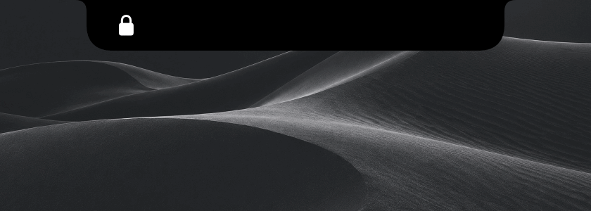
</p>

> [!WARNING]
> **A 2D camera is not Face ID.** A video of you, and possibly a good photo or mask, could unlock your Mac. To unlock, the app saves your login password in your keychain and types it on the lock screen. It is provided as is, with no warranty. Keep Touch ID or your password for anything that matters.

## Contents

- [Features](#features)
- [How it looks](#how-it-looks)
- [Install](#install)
- [Set up](#set-up)
- [Settings](#settings)
- [Examples](#examples)
- [Security and privacy](#security-and-privacy)
- [Build from source](#build-from-source)
- [Project layout](#project-layout)
- [Status](#status)
- [Licence](#licence)

## Features

| | |
|---|---|
| **Beside the camera** | A padlock one side of the notch, your face the other. The face turns into a tick. |
| **Every Mac** | Notch, Dynamic Island, or a floating pill where there is neither. |
| **Liveness checks** | Glare and device-frame detection, a blink or head depth, and an optional random head turn. |
| **Appearances** | Separate scans for glasses, a hat and one alternate look, and it keeps up with you over time. |
| **Touch ID still decides** | Password or Touch ID after a restart, a time limit or too many attempts. |
| **Presence** | Lock when you leave, and keep the display awake while you’re looking. |
| **Private** | No network requests. Face data is encrypted numbers, never pictures. |

## How it looks

### Unlocking

| Beside a notch or island | No notch |
|:---:|:---:|
|  |  |

### Styles

| Notch | Dynamic Island | Pill |
|:---:|:---:|:---:|
| 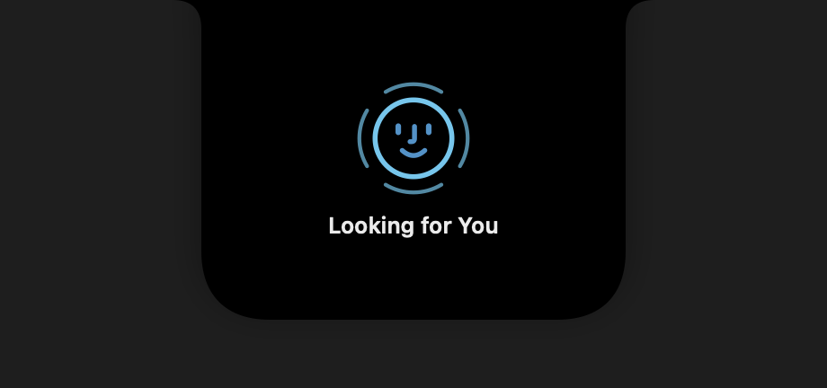 | 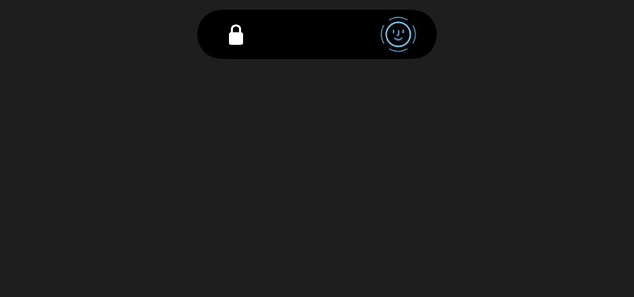 | 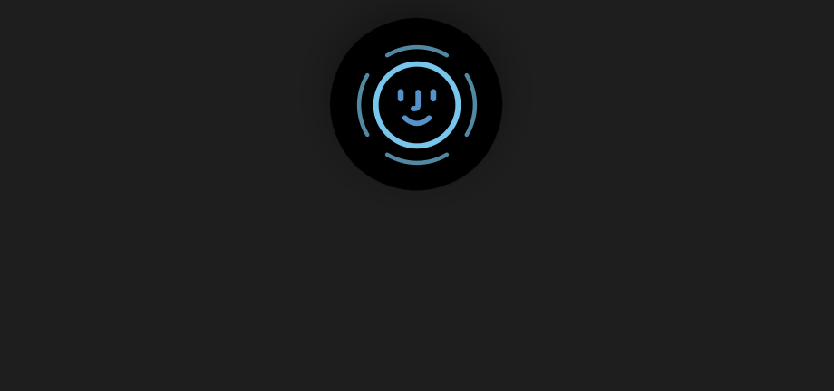 |

Automatic picks the compact style beside a notch or island, and the pill otherwise. **Settings → Appearance** lets you choose **Notch**, **Pill** or **Compact** yourself.

| Mac | What happens |
|---|---|
| MacBook with a notch | A padlock one side of the camera, the face the other. Messages drop below |
| Dynamic Island MacBook Pro (touch display, macOS 27) | The island widens the same way. **Untested on that hardware** |
| No notch: Intel, M1 Air, 13-inch Pro, external displays | A pill drops from the top edge and floats |

There is no public island API, so it is detected from the built-in display reporting touch, and its size is an estimate from Apple’s press images.

## Install

1. Open `FaceUnlock.dmg` and drag FaceUnlock to Applications.
2. Open it once. macOS blocks it because it isn’t notarized by Apple.
3. In **System Settings → Privacy & Security**, scroll down and click **Open Anyway**.

Only do this for software you trust, or [build it yourself](#build-from-source).

## Set up

<p align="center">
  
</p>

| 1. Get started | 2. Turn your head | 3. Done |
|:---:|:---:|:---:|
| 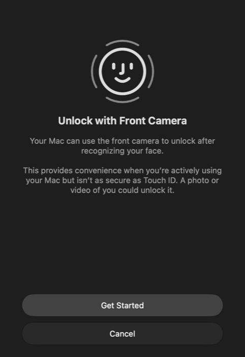 | 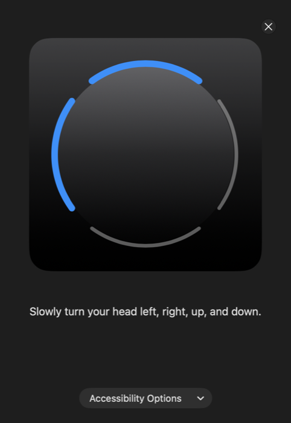 | 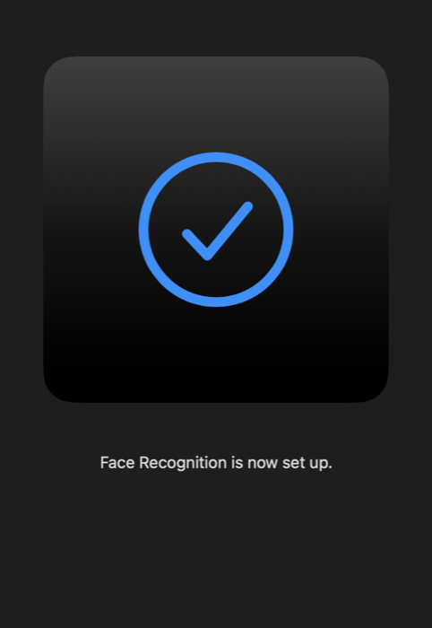 |

1. Choose **Set Up Face Recognition** and complete the head-turn scan.
2. Try **Settings → Face Unlock & Password → Test Recognition**. It types nothing and shows the match score.
3. Enter your Mac password and allow **Accessibility** (and **Notifications** if you like).
4. Turn on **Unlock with Front Camera** and confirm with Touch ID.
5. Lock with Control-Command-Q, wait a few seconds, move the pointer and look at the screen.

If anything goes wrong, use your password or Touch ID as usual. **Settings → Activity** shows what happened.

## Settings

| Face Unlock & Password | Security | Appearance |
|:---:|:---:|:---:|
| 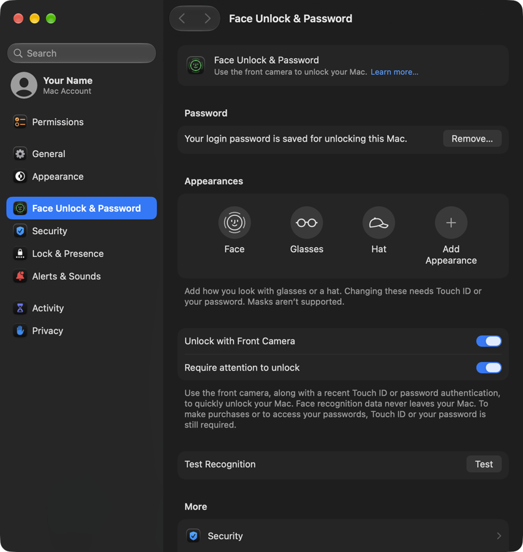 | 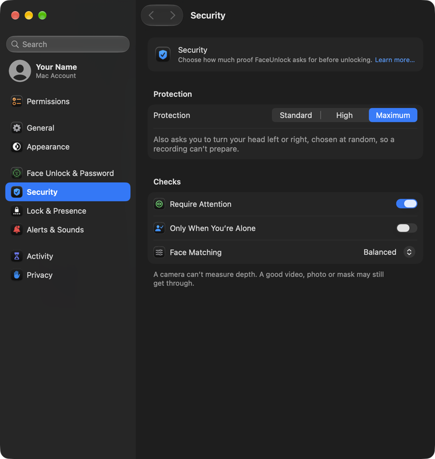 | 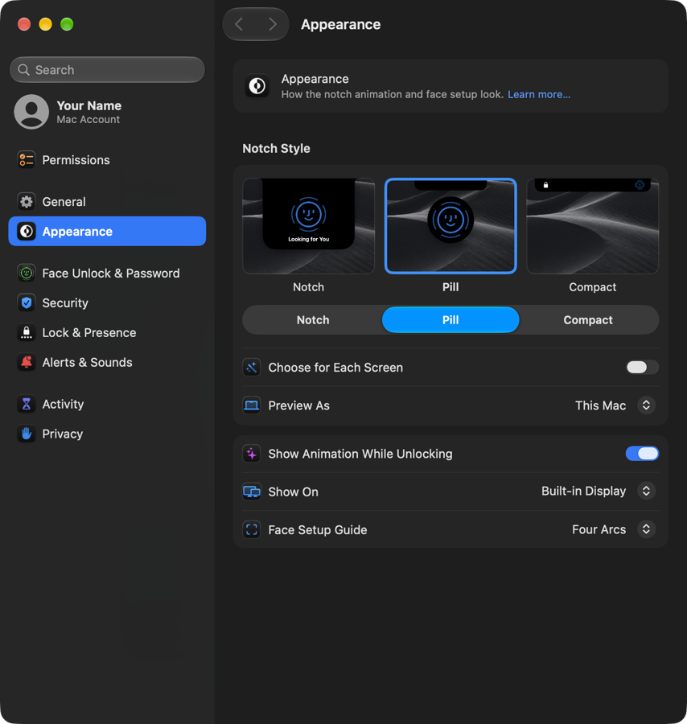 |

| Page | What’s there |
|---|---|
| General | Status, open at login, licences, support, detailed log |
| Appearance | Style, preview as another Mac, which display, setup guide |
| Face Unlock & Password | Password, appearances, the main switch, Test Recognition |
| Security | Standard, High or Maximum; attention, solitude, matching |
| Lock & Presence | Time limit (5 minutes to 3 hours), attempts, lock when you leave |
| Alerts & Sounds | Sounds, haptics, where alerts appear |
| Activity | Recent unlocks and refused attempts |
| Privacy | Automatic face updates, Reset FaceUnlock |

Every option is explained at [faceunlock.app/settings](https://faceunlock.app/settings.html).

## Examples

What you’ll see, and why:

| Turn your head | Not recognized | Password required |
|:---:|:---:|:---:|
| 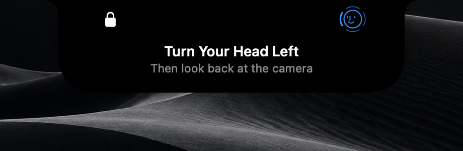 | 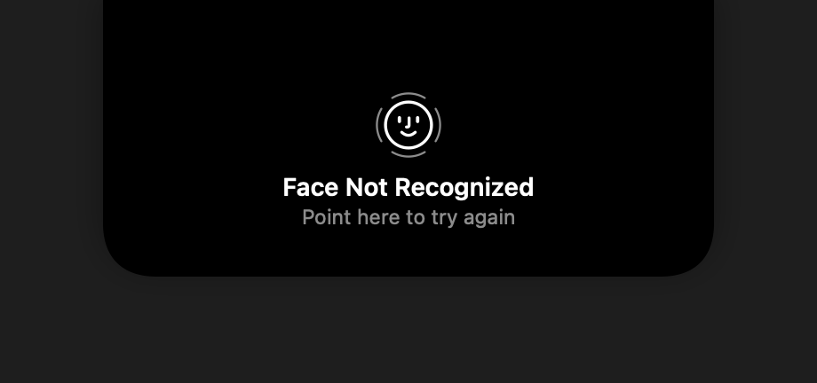 | 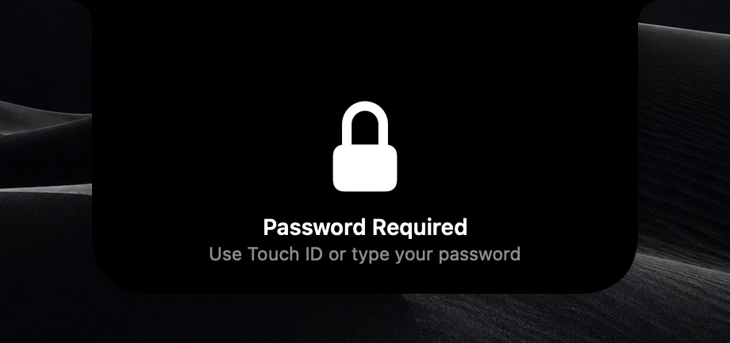 |

| Situation | Result |
|---|---|
| You wake the locked Mac and look at it | Recognized, tick, unlocked |
| Just locked | Waits for a wake or new input |
| Another face, or a detected spoof | Refused. 5 of these (or 3 or 4, your choice) require your password |
| Your face, but no blink or head turn | Point at the notch to retry. Each try counts towards the limit |
| App just launched, time limit passed (45 minutes by default), or typing failed | Password or Touch ID required |
| You lower a protection setting | Touch ID or your password is asked for first |
| Attempts refused while locked | Reported after you unlock |
| Lock When You Leave is on and you walk off | 5-second warning, then it locks |
| Lid closed | Does nothing |

## Security and privacy

**Before your password is typed:**

1. The face matches yours (Balanced or Strict).
2. No screen glare or phone-shaped edges.
3. **High** (default): a blink, or the depth of your nose showing as your head turns slightly.
4. **Maximum**: also a head turn in a random direction.
5. Optionally: eyes open and facing the screen, and nobody else in view.

**Hardening:**

- Lock and unlock notices from macOS are believed only when the screen itself agrees, since other programs can imitate them.
- Security choices are kept in your keychain. Lowering any, or changing face data, needs Touch ID or your password.
- The password is typed only while the screen is locked and your account is on screen, and is never retried after a failure.
- The installed release uses the hardened runtime. The development build does not.

**Your data:**

- Face data is stored as numbers, not pictures, encrypted in `~/Library/Application Support/FaceUnlock`.
- The password and encryption key are in your login keychain. There is no Secure Enclave protection for matching.
- The app makes no network requests.
- **Settings → Privacy → Reset FaceUnlock** deletes all of it.
- With **Update Face Data Automatically** on (the default), up to eight newer captures are kept beside your setup scan, after a face unlock or when your password follows a scan that didn’t unlock. A capture must still closely resemble the setup scan, and is dropped after 30 days unused or 60 matches.

Found a security problem? Please don’t post it publicly: email security@faceunlock.app.

## Build from source

Needs Xcode and [XcodeGen](https://github.com/yonaskolb/XcodeGen).

Install a hardened release in `/Applications` (macOS may ask for permissions again):

```bash
./Tools/install.sh
```

Or build and run for development:

```bash
xcodegen generate && xcodebuild -project FaceUnlock.xcodeproj -scheme FaceUnlock -derivedDataPath build build && open build/Build/Products/Debug/FaceUnlock.app
```

Run the tests:

```bash
xcodegen generate && xcodebuild -project FaceUnlock.xcodeproj -scheme FaceUnlock -destination 'platform=macOS' test
```

Redraw the screenshots and animations (development builds only; `--demo` hides your details):

```bash
build/Build/Products/Debug/FaceUnlock.app/Contents/MacOS/FaceUnlock --snapshots shots --demo --backdrop picture.jpg
```

Intel Macs can run it on macOS 26 (macOS 27 drops Intel); `./Tools/install.sh` builds a universal app.

### Sounds

The official download plays effects timed to the animations, with trackpad haptics on the same beats. **The sound files are not in this repository** ([they are reserved](LICENSE-ASSETS.md)), so an app you build yourself is silent. You can add your own WAV files to `Resources/Sounds`, named as in `Sources/System/Sounds.swift`.

## Project layout

| Folder | Contents |
|---|---|
| `Sources/Core` | Unlock rules, security settings, setup state machine, matching (unit tested) |
| `Sources/Vision` | Camera, face landmarks, embedding |
| `Sources/Liveness` | Glare, device-frame, head-depth and blink checks |
| `Sources/System` | Keychain, lock screen, notifications, activity log |
| `Sources/UI` | Setup, settings, glyph animations, notch panel |
| `Models` | SFace ([OpenCV Zoo](https://huggingface.co/opencv/face_recognition_sface), Apache-2.0), converted by `Tools/convert_sface.py`. An optional anti-spoofing model is [not included](ThirdParty/NOTICES.md) |
| `Tests` | Unit tests |
| `Tools` | Install, icon and model conversion scripts |

The website’s source is kept separately.

## Status

**Confirmed** on one MacBook Pro, macOS 27.0.1: recognition, real lock-screen unlocks with the liveness, typing and animation code.

**Not confirmed:** photo and video attempts against the liveness checks (tested on simulated data only), the Maximum challenge, the head-turn setup scan, glasses and hat scans, another person, dim light, lock-when-you-leave, a real time-limit expiry, Intel Macs, and Macs without a notch or with a Dynamic Island. Masks are not supported.

## Licence

The source code is under the [MIT License](LICENSE). The sounds, logos, icon, artwork and design are **not**: all rights reserved, see [LICENSE-ASSETS.md](LICENSE-ASSETS.md). To share your own version, replace them with your own.

Third-party parts keep their own licences: [ThirdParty/NOTICES.md](ThirdParty/NOTICES.md).

Not made by or affiliated with Apple. Apple, Mac, Face ID and Touch ID are Apple trademarks. Apple icons and artwork shown in the website and app belong to Apple, and other app icons to their owners.
