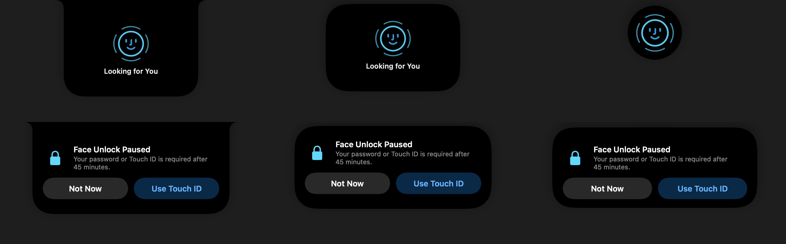

# FaceUnlock for Mac

A free, open-source menu bar app that brings iPhone Duo’s “Unlock with Front Camera” to macOS 26 and later.

**[Download for Mac](https://github.com/MangoDman/FaceUnlock/releases/latest/download/FaceUnlock.dmg)** · [Website](https://faceunlock.app) · [Feedback](https://faceunlock.app/feedback.html) · [Research](RESEARCH.md)



> **Know the trade-off.** A 2D camera is not Face ID. A video of you, and possibly a good photo or mask, could unlock your Mac. To unlock, the app saves your login password in your keychain and types it on the lock screen. It is provided as is, with no warranty. Keep Touch ID or your password for anything that matters.

## Install the download

1. Open `FaceUnlock.dmg` and drag FaceUnlock to Applications.
2. Open it once. macOS blocks it because it isn’t notarized by Apple.
3. In **System Settings → Privacy & Security**, scroll down and click **Open Anyway**.

Only do this for software you trust, or build it yourself.

## Build it yourself

Needs Xcode and [XcodeGen](https://github.com/yonaskolb/XcodeGen).

```bash
./Tools/install.sh
```

Builds a hardened release and installs it in `/Applications` (macOS may ask for permissions again). For development:

```bash
xcodegen generate && xcodebuild -project FaceUnlock.xcodeproj -scheme FaceUnlock -derivedDataPath build build && open build/Build/Products/Debug/FaceUnlock.app
```

The development build has no hardened runtime, so other software could inject code into it and reach the saved password. Use the installed release day to day.

## First run

1. **Set Up Face Recognition** and complete the head-turn scan. You can add glasses, a hat or an alternate look afterwards.
2. **Settings → Face Unlock & Password → Test Recognition**. It types nothing and shows the match score and liveness cue.
3. Enter your Mac password and allow **Accessibility** and **Notifications**.
4. Turn on **Unlock with Front Camera**, then confirm with Touch ID.
5. Lock with Control-Command-Q, wait a few seconds, move the pointer and look at the screen.

If anything goes wrong, use your password or Touch ID as usual. **Settings → Activity** shows what happened.

## What it checks before typing your password

1. The face matches yours (Balanced or Strict).
2. No screen glare or phone-shaped edges.
3. **High** (default): a blink, or the depth of your nose showing as your head turns slightly.
4. **Maximum**: a head turn in a random direction.

Also optional: eyes open and facing the screen, and only when nobody else is in view.

## Behaviour

| Situation | Result |
|---|---|
| Just locked | Waits for a wake or new input |
| Another face or a detected spoof | Refused; 5 of these (or 3 or 4, your choice) require your password |
| Your face, no proof of life | Hover the notch to retry; not counted |
| App just launched, the time limit passed (45 minutes by default, 5 minutes to 3 hours), or typing failed | Password or Touch ID required, shown in the notch |
| Attempts refused while locked | Reported after you unlock |
| Lock When You Leave (off by default) | 5-second warning, then locks |
| Lid closed | Does nothing |

What appears depends on the screen (chosen automatically):

| Mac | Behaviour |
|---|---|
| MacBook with a notch | The whole notch grows downward |
| Dynamic Island MacBook Pro (touch display, macOS 27) | The island grows into a floating card |
| No notch: Intel, M1 Air, 13-inch Pro, external displays | A pill drops from the top edge and floats, detached |

There is no public island API, so it is detected from the built-in display reporting touch; the island's size is an estimate from Apple's press images and is **untested on that hardware**, as is Intel. **Settings → Appearance** has a style slider, **Preview As** for each Mac type, and **Show On**. Intel Macs can run it on macOS 26 (macOS 27 drops Intel); `./Tools/install.sh` builds a universal app.

## Status

Confirmed on one MacBook Pro, macOS 27.0.1: recognition, real lock-screen unlocks with the liveness, typing and animation code.

Not confirmed: photo and video attempts against the liveness checks (tested on simulated data only), the Maximum challenge, the head-turn setup scan, glasses and hat scans, another person, dim light, lock-when-you-leave, a real time-limit expiry, Intel Macs, and Macs without a notch or with a Dynamic Island.

## Website

[faceunlock.app](https://faceunlock.app). Its source is kept separately.

## Sounds

Stereo effects for the notch opening and closing, unlocking, locking, refusals, alerts and setup, synthesised by `Tools/make_sounds.py` (no recordings). Their timing and the trackpad taps follow the animations. Turn them or the haptics off in **Settings → Alerts & Sounds**.

## Privacy

Face data is stored as numbers, not pictures, encrypted in `~/Library/Application Support/FaceUnlock`. The password and encryption key are in your login keychain. The app makes no network requests. There is no Secure Enclave protection for matching. **Settings → Privacy → Reset FaceUnlock** deletes all of it.

Under **Face Unlock & Password → Appearances** you can add separate scans with glasses, with a hat, and one alternate look. Adding, rescanning or removing them needs Touch ID or your password. Masks are not supported.

With **Update Face Data Automatically** on (the default), FaceUnlock keeps up to eight newer captures beside your setup scan, the way Face ID adapts: after a face unlock, or when your password or Touch ID follows a scan that didn't unlock (including once the time limit has passed). A capture is kept only if it still resembles the setup scan, and is dropped after 30 days without matching or after 60 matches.

## Layout

- `Sources/Core`: unlock rules, setup state machine, matching (unit tested)
- `Sources/Vision`: camera, face landmarks, embedding
- `Sources/System`: keychain, lock screen, notifications, activity log
- `Sources/Liveness`: glare, device-frame, head-depth and blink checks
- `Sources/UI`: setup, settings, glyph animations, notch panel
- `Models`: SFace ([OpenCV Zoo](https://huggingface.co/opencv/face_recognition_sface), Apache-2.0), converted by `Tools/convert_sface.py`. An optional anti-spoofing model is [not included](ThirdParty/NOTICES.md)
- `Tools/make_icon.sh`: regenerates the app icon

Not made by or affiliated with Apple. Apple, Mac, Face ID and Touch ID are Apple trademarks. Apple icons and artwork shown in the website and app belong to Apple, and other app icons to their owners.

## Licence

The source code is under the [MIT License](LICENSE). The sounds, name, logos, icon, artwork and design are **not**: all rights reserved, see [LICENSE-ASSETS.md](LICENSE-ASSETS.md). To share your own version, replace them with your own.

Third-party parts keep their own licences: [ThirdParty/NOTICES.md](ThirdParty/NOTICES.md).
